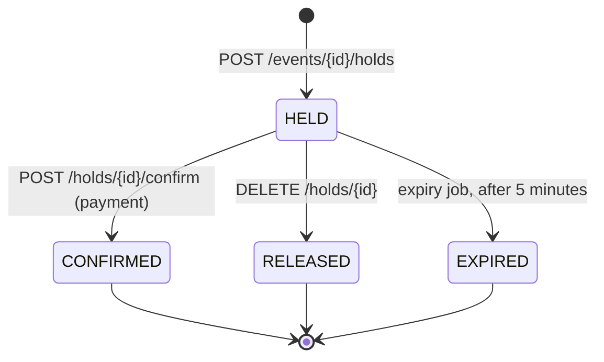

# Seat Booking API

A Spring Boot REST API for selling concert seats that **never sells the same seat twice**, even when hundreds of people click "buy" in the same second, a client retries after a timeout, or the app runs on several servers.

The interesting part is not the CRUD but the correctness under concurrency: row-level locks, deadlock-free lock ordering, idempotency keys, hold expiry with `SKIP LOCKED`, and database constraints as the last line of defence. Each of these is covered by a test that runs real concurrent transactions against PostgreSQL.

```http
POST /api/events/1/holds
Idempotency-Key: 6f1c1a0e-checkout-42
Content-Type: application/json

{ "customerEmail": "an@example.com", "quantity": 2 }
```
```http
HTTP/1.1 201 Created
Location: /api/holds/b1ff1794-9129-43ee-a385-8b801519f7bc

{"id":"b1ff1794-...","eventId":1,"status":"HELD","seats":["A10","A11"],"totalPriceVnd":1600000,"expiresAt":"2026-11-07T06:07:31Z"}
```
```http
POST /api/events/1/holds          (someone else, a moment later)
{ "customerEmail": "binh@example.com", "seatIds": [10] }

HTTP/1.1 409 Conflict
{"status":409,"detail":"Seats already taken: A10"}
```

## Tech stack

Java 21 · Spring Boot 3.4 · Spring Data JPA (Hibernate 6) · PostgreSQL · Flyway · Bean Validation · `@Scheduled` jobs · springdoc OpenAPI · JUnit 5, MockMvc and multi-threaded integration tests · GitHub Actions on H2 and PostgreSQL

## How a booking works



Seats go `AVAILABLE → HELD → SOLD`, or back to `AVAILABLE` when a hold is released or expires.

| Method | Path | Description |
|---|---|---|
| GET | `/api/events` | Events |
| GET | `/api/events/{id}/seats` | Seat map by row, with status and price |
| POST | `/api/events/{id}/holds` | Hold chosen `seatIds`, or the best `quantity` adjacent seats. Requires `Idempotency-Key` |
| GET | `/api/holds/{id}` | Hold status |
| POST | `/api/holds/{id}/confirm` | Pay: seats become `SOLD`. `410 Gone` if the hold expired |
| DELETE | `/api/holds/{id}` | Give the seats back |

Swagger UI: `http://localhost:8080/swagger-ui.html`.

## Correctness under concurrency

### 1. Row locks: `SELECT ... FOR UPDATE`

```java
@Lock(LockModeType.PESSIMISTIC_WRITE)
@Query("select s from Seat s where s.eventId = :eventId and s.id in :ids order by s.id")
List<Seat> lockSeats(long eventId, Collection<Long> ids);
```

The seats are read with a row lock in the same transaction that changes them. If 30 people request seat A10 at once, one transaction gets the lock; the other 29 wait on that row, and when the first commits they see `HELD` and get `409 Conflict`. Checking `status == AVAILABLE` without the lock would let several requests see "available" before any of them writes: a classic check-then-act race.

Because the guarantee is in the database, it still holds with several application instances behind a load balancer; a Java `synchronized` block would not.

### 2. Lock ordering prevents deadlocks

Request X wants seats {5, 6} and request Y wants {6, 5}. If X locks 5 then waits for 6 while Y locks 6 then waits for 5, both wait forever and PostgreSQL has to kill one. The query locks rows `order by s.id`, so every transaction locks in the same global order and this cycle cannot form. A test sends 40 overlapping two-seat requests in shuffled order and checks that no request fails with anything other than a clean `409`.

### 3. Idempotency keys

Mobile networks drop responses. A client that never got an answer retries, and without protection a retry can create a second hold. Every `POST` carries an `Idempotency-Key`:

- Same key, same body: the original hold is returned with `200` and `Idempotent-Replayed: true`. Nothing new is created.
- Same key, different body: `422 Unprocessable Entity`. The body is identified by a SHA-256 of its canonical form.
- Two identical requests at the same instant: both pass the "key not seen" check, but `UNIQUE (idempotency_key)` lets only one insert commit; the other gets `409` and can retry.

### 4. Optimistic locking as a second layer

`Seat` has a `@Version` column. Every write already happens under a row lock, so the version should never conflict. It exists to catch a future bug where some code path forgets the lock. **Verified experimentally:** removing `@Lock` from `lockSeats` makes all three concurrency tests fail with `ObjectOptimisticLockingFailureException`. Seats are still never double-sold, but customers would see errors instead of a clear answer.

### 5. Expiry with `FOR UPDATE SKIP LOCKED`

A scheduled job releases holds that were not paid within 5 minutes. It selects expired holds with `SKIP LOCKED` (`jakarta.persistence.lock.timeout = -2`). A hold that a customer is confirming right now is locked by that request, so the job skips it instead of waiting, and two instances of the job never process the same hold. Confirm and expiry of one hold are serialized by the hold's row lock, so a hold is never both sold and released.

### 6. Constraints in the database

```sql
CONSTRAINT chk_seat_hold CHECK ((status = 'AVAILABLE' AND hold_id IS NULL)
                             OR (status <> 'AVAILABLE' AND hold_id IS NOT NULL))
```

Plus `UNIQUE (event_id, row_label, seat_number)`, `CHECK` on every status column, and foreign keys. If application code ever tries to write an inconsistent seat, the database rejects it.

## Best available seats

`quantity: 4` asks the server for the best block of 4 adjacent seats (`seat/BestSeats.java`). For each row a sliding window of width k moves over the seats; a window is valid if all its seats are available and their numbers are consecutive, so a block never spans an aisle. The score is `rowIndex × 2 + distance from the row's centre`, so one row further back costs the same as two seats further from the middle. One pass over all seats: O(n).

The map is read without locks, then only the chosen seats are locked and re-checked. If someone took one in between, the service reads the map again (up to 3 times). This keeps locks short and narrow instead of locking a whole event during the search.

## Tests

| Test | What it proves |
|---|---|
| `ConcurrencyTest.thirtyCustomersOneSeatExactlyOneWins` | 30 threads, one seat: exactly 1 hold, 29 clean `409`s |
| `ConcurrencyTest.overlappingRequestsInAnyOrderNeverDeadlockOrDoubleBook` | 40 shuffled overlapping requests: no deadlock, no double booking |
| `ConcurrencyTest.bestSeatRequestsShareTheHallWithoutCollisions` | 12 groups asking for "best 4" at once: every held seat belongs to exactly one hold |
| `HoldApiTest` | idempotent replay, `422` on key reuse, confirm, release, expiry (`410`), validation |
| `BestSeatsTest` | centre preference, row vs. centre trade-off, aisles, ties |

Time is injected as a `java.time.Clock`, so the expiry test moves the clock 6 minutes forward instead of sleeping.

```bash
mvn test        # H2 in PostgreSQL mode
SPRING_DATASOURCE_URL=jdbc:postgresql://localhost:5432/booking \
SPRING_DATASOURCE_USERNAME=booking SPRING_DATASOURCE_PASSWORD=booking mvn test
```

CI runs the whole suite on both databases.

## Run it

```bash
mvn spring-boot:run                                   # H2, no setup
docker compose up -d && mvn spring-boot:run -Dspring-boot.run.profiles=postgres
```

## Limitations

- Payment is simulated by the confirm endpoint; there is no payment provider.
- No authentication: any client can confirm any hold id it knows (ids are random UUIDs).
- One hold holds up to 8 seats of one event.
